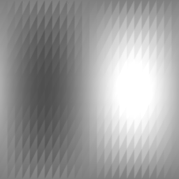
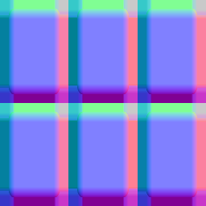
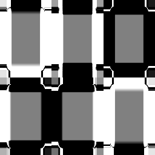
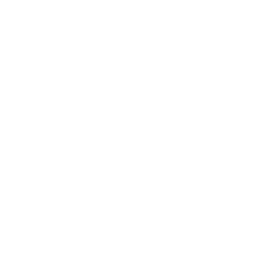
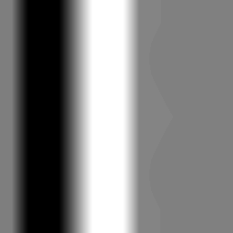

# NormalBake

[](https://github.com/mattscott/normalbake/actions/workflows/ci.yml) [](LICENSE)

A standalone, permissively-licensed, **dependency-light, cross-platform managed-C# (.NET 8)** library +
CLI that bakes a **normal map** (and AO, curvature, position, thickness, object ID) from a
high-resolution mesh into the UV space of a low-resolution (quad-remeshed) mesh — so the low-poly
*renders* with the high-poly's surface detail at a fraction of the triangle count.

It is a **clean-room** implementation — the projection bake (Cignoni et al. 1998), a MikkTSpace-faithful
tangent basis, and a managed Woop-watertight BVH ray tracer — with **no native dependencies** and an
MIT-clean graph. Output is **deterministic** (bit-identical for fixed parameters, regardless of thread
count).

## Pipeline

NormalBake is the **baking** stage of a three-tool chain (the upstream remesh and UV unwrap are
separate tools):

```
quad-remesher (retopology) ─► UV-unwrap tool ─► NormalBake (this tool) ─► normal map
```

The low-poly **must already carry UVs**; NormalBake validates them (non-overlap, gutters, finiteness)
and bakes the high-poly's detail into UV space. The two levers that decide whether a bake looks right
are a **MikkTSpace-synced tangent basis** and a good **cage/projection** envelope.

## Install

NormalBake is not on NuGet yet. Build the packages from source:

```sh
dotnet pack -c Release -o artifacts

# CLI as a global tool, from the local packages:
dotnet tool install --global --add-source ./artifacts NormalBake.Tool

# or reference the libraries from the same local source:
dotnet add package NormalBake.Core --source ./artifacts
dotnet add package NormalBake.IO --source ./artifacts
```

## CLI usage

```sh
normalbake <high.obj> <low.obj> -o <out.png> [options]
```

The output **format is chosen by extension**: `.png` (8/16-bit), `.dds` (BC5, or `--bc7`), `.exr` (float).

```sh
# 2K tangent-space normal map, 16-bit PNG (default):
normalbake high.obj low.obj -o normal.png --res 2048

# ambient occlusion to a DDS (BC5):
normalbake high.obj low.obj -o ao.dds --map ao --occ-samples 64

# object-space normal, DirectX green, 4x supersampling:
normalbake high.obj low.obj -o normal.png --space object --convention dx --samples 4
```

| Option | Meaning |
|---|---|
| `--map <type>` | `normal` (default) · `position` · `ao` · `thickness` · `curvature` · `id` |
| `--res <n>` | output resolution (default 2048) |
| `--samples <n>` | N×N supersampling per texel (default 4) |
| `--convention <gl\|dx\|unreal>` | green-channel convention (default OpenGL; `unreal`/`dx` = green-down, for Unreal/UE3-UE5, 3ds Max, Source) |
| `--space <tangent\|object>` | normal frame (default tangent) |
| `--bitdepth <8\|16>` | PNG bit depth (default 16) |
| `--frontal/--rear <d>` | cage envelope distances (0 = auto from bounds) |
| `--occ-samples <n>` | hemisphere rays for AO/thickness (default 32) |
| `--threads <n>` | worker threads (-1 = all cores) |
| `--bc7` | use BC7 instead of BC5 for `.dds` |
| `--no-fallback` | don't fill cage misses from the nearest surface |

## Library API

```csharp
using NormalBake.Core;
using NormalBake.IO;

Mesh high = ObjReader.ReadMesh("high.obj");
UvMesh low = ObjReader.ReadUvMesh("low.obj"); // must already have UVs

BakedMap map = NormalBaker.Bake(high, low, new NormalBakeOptions
{
    Resolution = 2048,
    Samples = 4,
    Map = MapType.Normal,
});

PngWriter.Write("normal.png", map);          // or DdsWriter / ExrWriter
```

Multi-part assets bake each piece against **only its own** high-poly (no proximity bleed):

```csharp
var parts = NormalBaker.MatchByName(highsByName, lowsByName); // pairs crate_low ↔ crate_high
BakedMap atlas = NormalBaker.BakeParts(parts, options);
```

`Bake` also has an overload taking `IProgress<float>` and a `CancellationToken` for long bakes.

## Samples

Baked from the procedural corpus (`tests/corpus/`) — normal, ambient occlusion, curvature:

| | Normal | AO | Curvature |
|---|---|---|---|
| sphere |  |  |  |
| box |  |  |  |
| cylinder |  |  |  |

## Layout

```
src/
  NormalBake.Core/   library: BVH ray tracer, MikkTSpace tangents, projection bake, encoding
  NormalBake.IO/     OBJ, glTF and binary FBX readers; PNG, DDS (BCnEncoder.NET), EXR writers
  NormalBake.Cli/    the `normalbake` command-line tool
tests/
  NormalBake.Tests/  unit + analytic-oracle tests;  corpus/  procedural mesh pairs
tools/
  reference-oracle/  Blender-headless golden scripts (oracle cross-check);  benchmark.ps1
```

## Build & test

```sh
dotnet build
dotnet test
```

Requires the .NET 8 runtime (the SDK may be newer; `global.json` rolls forward). CI builds Release and
runs the suite on Windows + Linux.

## Contributing

See [CONTRIBUTING.md](CONTRIBUTING.md). Please report security issues privately ([SECURITY.md](SECURITY.md)).

## License

MIT — see [LICENSE](LICENSE). Algorithmic attributions and third-party notices are in [NOTICE](NOTICE).
The only runtime dependency is BCnEncoder.NET (MIT/Unlicense) for DDS; everything else is hand-rolled.
